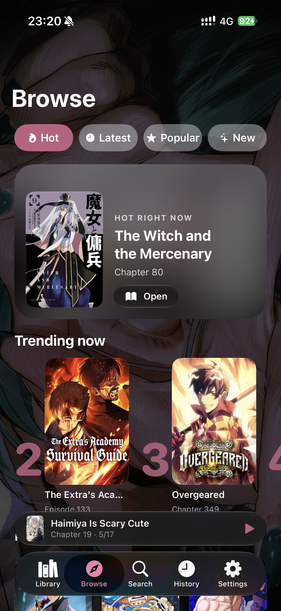
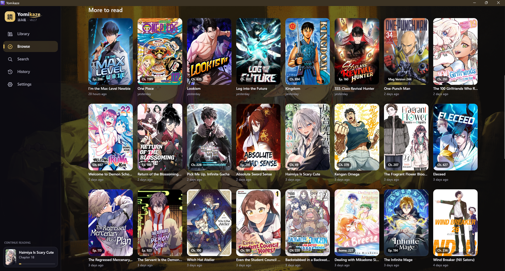

# Yomikaze

**読み風** · A free manga reader for iPhone, iPad and Windows.

Yomikaze lets you browse, read and download manga from the WeebCentral catalog. Your library,
reading progress and settings stay on your own device. There are no accounts, no ads and no tracking.

  
  &nbsp;&nbsp;
  

## Features

- **Library**: save series, sort them into your own categories, and see where you left off
- **Browse and search**: hot, latest, popular and new series, search by title or author, genres
- **Reader**:
  - vertical scrolling for webtoons, or paged left to right or right to left
  - two pages side by side on a wide screen
  - a chapter list, zoom, tap zones, background colours and dimming
  - the next chapter loads before you get there
- **Offline reading**: download chapters and read them without a connection
- **History and statistics**: chapters and pages read, reading streaks
- **AniList sync** (optional): import your manga list, keep progress and favourites in sync,
  and rate a series on AniList when you finish it
- **Backgrounds**: anime wallpapers by popularity, famous series and genre, or your own picture
- **Backups**: export your library on one device and import it on another, even between
  iPhone and Windows
- **App lock** with Face ID or Windows Hello
- **Languages**: English, Hungarian, Spanish, Japanese, Chinese and a pirate language

## How it works

Yomikaze reads the public pages of WeebCentral and shows them in its own interface. Covers and
pages are cached, and downloaded chapters are stored on your device. Everything you do in the
app (library, progress, settings) is saved locally. AniList is only contacted if you connect
your account.

## Getting it

Downloads are on SourceForge (→ sourceforge.net).

- **Windows 10 / 11**: run the installer. It installs for your user only, no admin rights needed.
- **iPhone / iPad (iOS 26.1+)**: install the .ipa with a sideloading tool such as Sideloadly
  or AltStore.

## Building from source

| Folder | What it is |
| --- | --- |
| [yomikaze_windows/](yomikaze_windows) | Windows app, Rust with egui. Build steps are in its README. |
| [yomikaze_ios/](yomikaze_ios) | iPhone and iPad app, SwiftUI with XcodeGen. Build steps are in its README. |

AniList sync needs an API client of your own, both READMEs explain how to set one up.

## Notes

Yomikaze is not affiliated with WeebCentral or AniList. All manga, covers and artwork belong to
their respective owners.

AI was used during development to help find and fix bugs, translate the app, and with parts
I couldn't solve on my own.
